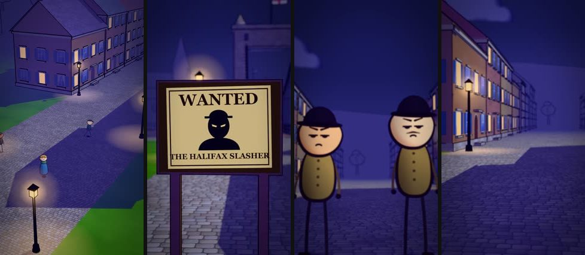
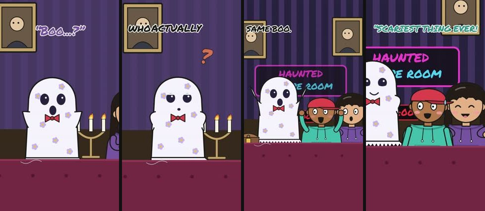
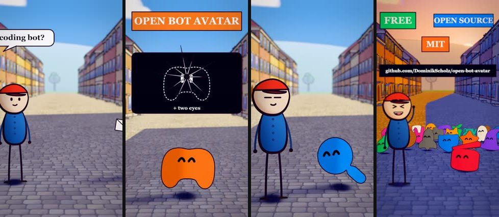

# animationStyles

The source, styles and SOP behind a batch of vertical animated shorts:

- **10 TOON3D videos:**
  - 4 history stories, each on a different set;
  - 4 AI explainers;
  - an Open Bot Avatar showcase, as a narrated short and as a launch promo.
- **20 DOODLE "Weird Worlds" story reels.**





| Read | For |
|---|---|
| **[SOP.md](SOP.md)** | Setup, the rules, the step-by-step for each format, and how to make them in bulk |
| **[STYLES.md](STYLES.md)** | Every style and video, with preview strips and the folder that builds it |
| [doodle-worlds/WORLDS-SLATE.md](doodle-worlds/WORLDS-SLATE.md) | The 20-reel idea slate and the rules it was built with |
| [toon3d/references/STYLE_BIBLE.md](toon3d/references/STYLE_BIBLE.md) | The TOON3D script + visual formula (upstream) |
| [CREDITS.md](CREDITS.md) | What came from where, and the licences |

Quick start (see SOP §0 for details):
```bash
pip install -r requirements.txt && playwright install chromium
cd toon3d && npm ci && COMP=Ai1Short node scripts/bridge-stills.mjs out/test_ 300 0.5
```

Using Claude Code? Open the repo in it: `CLAUDE.md` and `.claude/skills/` hold the pipeline, so you can just ask for
"a TOON3D AI explainer about X" or "Weird Worlds reel 21 from this slate row".

Not in the repo (by design):
- **API keys.** Copy `.env.example` to `.env`.
- **Generated audio and the rendered videos.** They rebuild from the recipes.
- **The Mixkit music files.** Their licence doesn't allow re-sharing, so `python tools/music/fetch.py` downloads them.
